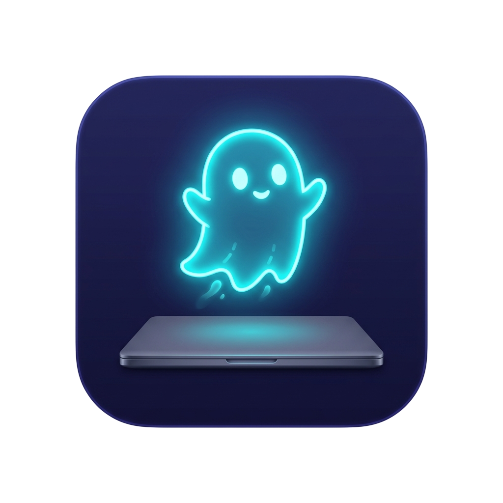

<div align="center">

  

  # 👻 Ghost Mode for macOS

  **The Lightweight Closed-Lid Keep-Awake & Display Power Controller**

  [](https://apple.com)
  [-brightgreen.svg)](https://apple.com)
  [](https://swift.org)
  [](LICENSE)
  [](https://github.com/malikarpit)

</div>

---

## 🌟 What is Ghost Mode?

**Ghost Mode** is a fast, native macOS menu bar utility engineered to keep your Mac running heavy background workloads (such as AI agents, model downloads, long compilations, torrents, or server processes) with the **MacBook lid closed**, while **instantly powering down the display backlight** to eliminate thermal buildup and conserve battery life.

---

## ✨ Features

- 👻 **Closed-Lid Keep-Awake:** Prevents macOS clamshell sleep without needing an external monitor or power brick connected.
- ⚡ **Zero-Overhead Display Power-Down:** Shuts down internal screen backlights and display rendering pipelines immediately upon lid closure to preserve energy and keep temperatures low.
- 📊 **Dynamic Live Progress Header:** Embedded native dashboard in the menu bar with real-time color-shifting progress tracking (🟢 >50%, 🟠 15–50%, 🔴 <15%).
- 🔘 **1-Click Quick Controls:** Start default sessions, stop sessions, and add instant `+30m` timer extensions directly from the dashboard header.
- ⏱️ **Granular Keep-Awake Timers:** 
  - Presets: `15m`, `30m`, `45m`, `1h`, `2h`, `4h`, `8h`, `Indefinite (∞)`
  - Extensions: `+15m`, `+30m`, `+45m`, `+1h`, `+2h`, `Custom...`
- 🛡️ **Triple Hardware Safety Shields:**
  - **Low Battery Cutoff:** Automatically disengages if battery drops below a user-selected threshold (`5%`, `10%`, `15%`, `20%`, or custom).
  - **AC Power Only Mode:** Keeps awake only while connected to power; automatically restores sleep if unplugged.
  - **Thermal Guard:** Continuously monitors macOS thermal state (`serious`/`critical`) and yields to sleep if your Mac runs too hot.
- 🚀 **Universal Launch & Accessibility:**
  - Launch from Spotlight or Launchpad at any time.
  - Single-instance protection with automatic menu reveal on re-launch.
  - Optional Dock icon toggle (`Preferences > Show App Icon in Dock`).
  - Optional Start at Login LaunchAgent integration.

---

## 📸 Menu Interface & Dashboard

```
┌──────────────────────────────────────────────┐
│  👻 Ghost Mode                        Active │
│  ━━━━━━━━━━━━━━━━━━━━━━━━━━━━━ 42:15 left    │
│  Sleep behaves normally      ⚡ 85% · Lid open│
│  [  🛑 Stop  ]              [     +30m     ] │
├──────────────────────────────────────────────┤
│  Extend More...                            ▶ │
│  Start Session for...                      ▶ │
│  Turn Off Screen Now 💤                      │
├──────────────────────────────────────────────┤
│  Turn Off Screen on Lid Close              ✓ │
│  Safety Protections                        ▶ │
│  Preferences                               ▶ │
├──────────────────────────────────────────────┤
│  Developed by Arpit                          │
│  Quit Ghost Mode                          ⌘Q │
└──────────────────────────────────────────────┘
```

---

## 🛠️ Building & Installation

### Prerequisites
* macOS 12.0 (Monterey) or later
* Xcode Command Line Tools (`xcode-select --install`)

### 1. Build and Install Directly to `/Applications`:
```bash
make install
```

### 2. Build Drag-and-Drop `.dmg` Installer:
```bash
make dmg
```
This generates `GhostMode-Installer.dmg` in the project root.

---

## 🔐 Privilege Configuration (Passwordless Sudo)

Managing macOS clamshell sleep behavior via `pmset` requires root privileges. Ghost Mode includes a secure setup helper that configures a scoped sudoers rule allowing only `/usr/bin/pmset` without password prompts:

```bash
sudo ./ghostmode_setup.sh
```
*Or simply click **Preferences > Setup Passwordless Sudo...** directly inside the app.*

---

## 🏗️ Architecture

- **Universal 2 Binary**: Natively compiled for both **Apple Silicon (M1/M2/M3/M4)** and **Intel 64-bit (`x86_64`)**.
- **In-Memory Timer Loop**: Attached to `RunLoop.Mode.common` so the UI never pauses while opening menus.
- **Subprocess Efficiency**: Subprocesses are kept to a minimum with cached privilege queries and native IOKit clamshell sensors.
- **Single Instance Enforcement**: Uses atomic POSIX advisory file locking (`flock`) combined with `NSRunningApplication` PID detection.

---

## 📄 License & Ownership

Developed and maintained by **Arpit**.  
Copyright © 2026 Arpit. All rights reserved.

Distributed under the [MIT License](LICENSE).
