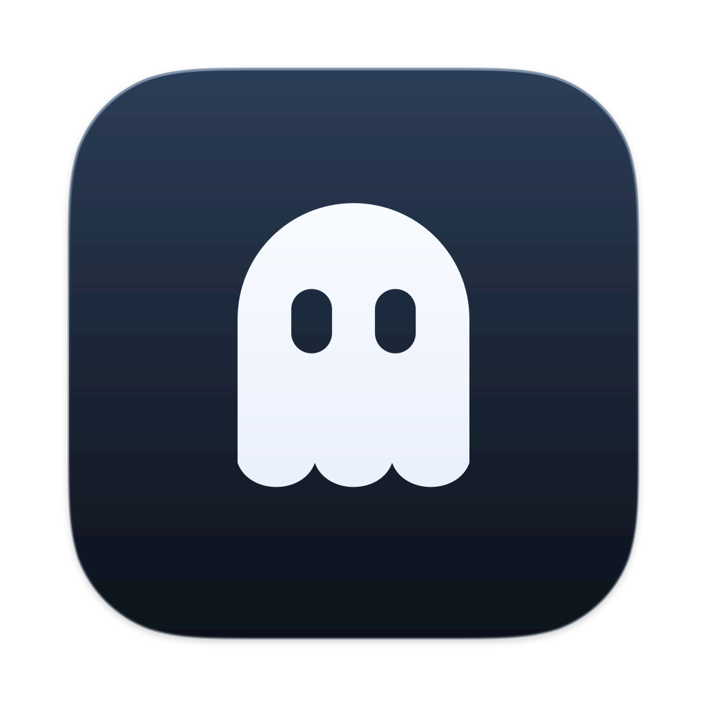
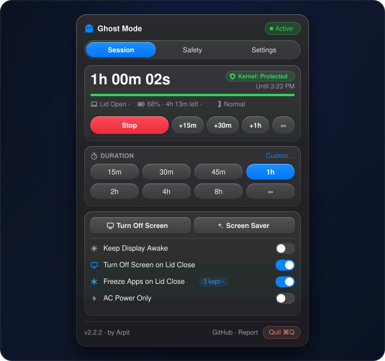
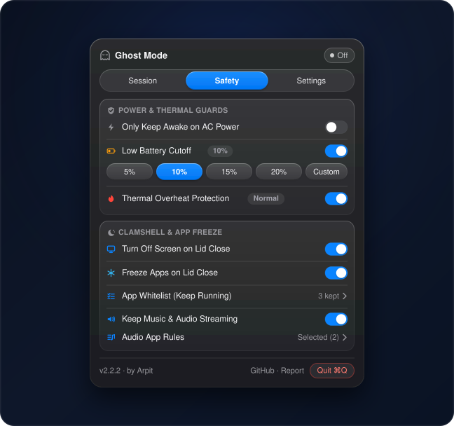
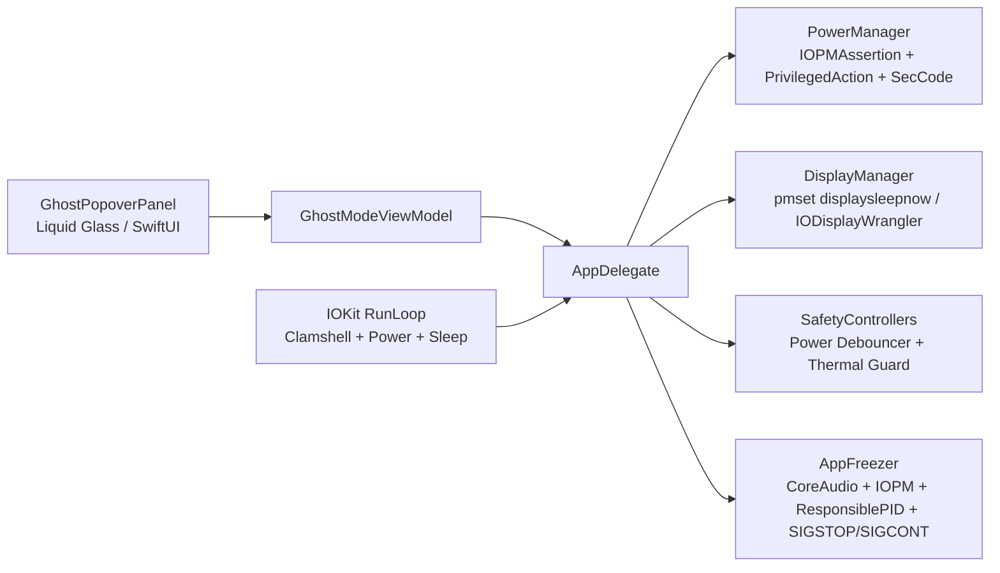

<div align="center">

  

  <h1>Ghost Mode</h1>

  <p>
    <strong>Native closed-lid keep-awake, display power controller, and app freezer for macOS</strong>
  </p>

  <p>
    <a href="https://github.com/malikarpit/Ghost-Mode/actions/workflows/ci.yml"></a>
    <a href="https://github.com/malikarpit/Ghost-Mode/releases/latest"></a>
    
    
    
    <a href="LICENSE"></a>
  </p>

  <p>
    <a href="https://github.com/malikarpit/Ghost-Mode/releases/latest">
      
    </a>
  </p>

  <p>
    <a href="#features">Features</a> &middot;
    <a href="#resource-management">Resources</a> &middot;
    <a href="#installation">Install</a> &middot;
    <a href="USER_GUIDE.md">User Guide</a> &middot;
    <a href="TROUBLESHOOTING.md">Troubleshooting</a> &middot;
    <a href="#architecture">Architecture</a> &middot;
    <a href="SECURITY.md">Security</a>
  </p>

</div>

---

## Why Ghost Mode?

MacBooks normally force sleep the moment you close the lid unless an external monitor, keyboard, and AC adapter are attached. **Ghost Mode** removes that limitation natively—keeping builds, AI agents, servers, downloads, and audio streams alive inside a closed laptop while shutting off the display backlight, freezing idle GUI apps in RAM, and watching battery and thermals in real time.

- **Native macOS 26+ Liquid Glass** (`NSGlassEffectView`) with crisp vibrancy fallback (`NSVisualEffectView`) on macOS 12–15
- **Full-Screen Space ready** (`NSPanel` floating over Desktop and full-screen Spaces alike, anchored smoothly from the menu bar)
- **Zero-dependency Swift** compiled directly with Apple Command Line Tools (`arm64` + `x86_64` Universal 2 binary)

---

## Features

- **Session & Display**: `15m`–`8h` / `∞` presets, `Custom...` duration (`90m`, `1.5h`), live `+15m`–`∞` extensions, **Turn Off Screen**, **Screen Saver**, **Keep Display Awake**, and live lid/battery/thermal telemetry.
- **Power & Thermal Guards**: **Only Keep Awake on AC Power**, **Low Battery Cutoff** (`5–20%` or custom `1–50%`), and **Thermal Overheat Protection** with live heat status.
- **Clamshell & App Isolation**: **Turn Off Screen on Lid Close**, **Freeze Apps on Lid Close** (`SIGSTOP`/`SIGCONT`), **App Whitelist (Keep Running)** (always awake, even when silent), and **Keep Music & Audio Streaming** (**Audio App Rules**: curated `Not Running` media presets, 10m dynamic audio detection, pause-to-freeze on macOS 14+, and locked `Whitelisted` indicators).
- **System & Diagnostics**: **Show Countdown in Menu Bar**, **Auto-Close Panel on Start**, **Auto-Start at Launch**, **Launch at Login**, **Show App Icon in Dock**, 1-click **Passwordless Sudo**, and live **Ghost Mode Footprint** + **Copy Diagnostics**.

> Full screen-by-screen vector walkthrough of every tab and control: [**USER_GUIDE.md**](USER_GUIDE.md)

<p align="center">
  
  
</p>

---

## Resource Management

Built to sit at **0% steady CPU** in your menu bar—using event callbacks instead of background polling:

| State | CPU | RAM (`phys_footprint`) | Active Work |
| --- | --- | --- | --- |
| **Idle / Active Session** | **0.0%** | **~36 MB** *(80 KB GPU)* | Menu bar item + IOKit RunLoop callbacks only |
| **Popover Open** | **< 1%** *(~3% burst)* | **~42–45 MB** *(~7.8 MB GPU)* | Liquid Glass SwiftUI UI, app icons, `5s` visible refresh |
| **Closed (`> 5s` teardown)** | **0.0%** | **~36 MB** *(80 KB GPU)* | UI views, icons, and compositor surfaces released |

- **Lazy UI & 5s Teardown**: Allocates the panel/SwiftUI host only when opened and releases views, icons, and glass layers `5s` after closing.
- **Visibility-Gated Work**: Skips icon loading, audio scans, `sudo -n` checks, and telemetry whenever hidden.
- **In-Process IOKit & CoreAudio Listeners**: Reads `IOPMrootDomain` `SleepDisabled` in-process (zero `pmset -g` subprocesses) and reacts to CoreAudio + `NSWorkspace` events on macOS 14+ instead of 2s polling.
- **System Effect When Closed**: Turning off the screen backlight and pausing idle GUI apps at `0%` CPU substantially cuts closed-lid battery drain and heat.

---

## Installation

### Easiest Install (Prebuilt Universal DMG)

1. Download **`GhostMode-Installer.dmg`** from [**GitHub Releases**](https://github.com/malikarpit/Ghost-Mode/releases/latest), open it, and drag **Ghost Mode.app** into **Applications**.
2. **Allow first launch** *(open-source build, ad-hoc signed without paid Apple notarization)*:
   - **Fastest (one command in Terminal — clears quarantine cleanly for Launch at Login & Finder):**
     ```bash
     xattr -cr "/Applications/Ghost Mode.app"
     ```
   - **No-Terminal option:** Double-click **Ghost Mode.app** once &rarr; open **System Settings &rarr; Privacy & Security &rarr; Open Anyway**.
3. **Launch Ghost Mode** and click the ghost icon in your menu bar.
4. **Enable frictionless closed-lid controls (recommended):** Open **Settings &rarr; Passwordless Sudo &rarr; Setup...** once so Screen Off, App Freeze, and sleep restoration run silently with no password prompts.

> Having trouble with Gatekeeper, lock screen prompts, audio rules, or cached icons? See [**TROUBLESHOOTING.md**](TROUBLESHOOTING.md).

### Build From Source

| Requirement | Details |
| --- | --- |
| **OS** | macOS 12.0+ (Apple Silicon) &middot; macOS 14.0+ (Intel via CLT; macOS 12.0+ with Xcode) |
| **Toolchain** | Apple Command Line Tools (`xcode-select --install`) or Xcode |

```bash
git clone https://github.com/malikarpit/Ghost-Mode.git
cd Ghost-Mode

# Build Universal 2 bundle, run all 262 unit tests & install to /Applications
make test && make install

# Optional: package GhostMode-Installer.dmg | clean uninstall
make dmg
make uninstall
```

---

## Closed-Lid Privilege Modes

macOS requires `root` access to toggle kernel sleep (`pmset disablesleep 1/0`). Ghost Mode never elevates silently—closed-lid automation stays disabled until you configure passwordless sudo:

| Capability | Passwordless Sudo Configured | Not Configured |
| --- | --- | --- |
| Start / stop closed-lid keep-awake | Instant (no prompt) | Prompts for admin password on start/stop |
| Turn Off Screen on Lid Close | Enabled | Visually off &amp; disabled |
| Freeze Apps on Lid Close, Whitelist &amp; Audio Rules | Enabled | Visually off &amp; disabled |
| Safety cutoffs while lid stays closed | Silent sleep restore immediately | Waits in *Sleep Restore Pending* until lid opens |
| Open-lid display keep-awake &amp; battery/thermal guards | Enabled | Enabled (native IOKit assertions) |

---

## Passwordless Sudo Setup & Revocation

- **In App**: **Settings &rarr; Passwordless Sudo &rarr; Setup...** (or **Setup** in the warning banner), and **Revoke...** anytime to remove `/private/etc/sudoers.d/ghostmode`.
- **Terminal Helper**:
  ```bash
  sudo ./ghostmode_setup.sh
  ```

<details>
<summary>Security protections around Setup, Revoke, and App Freezing</summary>

- **Closed `PrivilegedAction` Enum**: No arbitrary command string API is exposed; AppleScript elevation is private to `PowerManager`.
- **No Mutable Script in GUI Flow**: GUI setup constructs its validated command inside the compiled binary rather than reading `ghostmode_setup.sh` from disk.
- **Runtime Code-Signature Verification**: Before any admin elevation, `SecCodeCopySelf` + `SecStaticCodeCreateWithPath` validate both running process and on-disk bundle integrity.
- **Anti-TOCTOU Staging &amp; Least Privilege**: Stages inside a `0700 root:wheel` directory under `0750 root:wheel` `/private/etc/sudoers.d` with locked `PATH`, symlink checks, `visudo -cf`, and strict `Cmnd_Alias GHOSTMODE_PMSET = /usr/bin/pmset disablesleep 0, /usr/bin/pmset disablesleep 1, /usr/bin/pmset -g`.
- **Deadlock-Safe App Freezing**: Excludes core commands (`/bin`, `/sbin`, `/usr/bin`, `/usr/sbin`, `/usr/libexec`, `/System/Library`, `/Library/Apple` + Cryptex), core OS bundles, and Ghost Mode ancestors; freezes child helpers before main apps and resumes parents before helpers, backed by crash orphan recovery (`frozen_pids.json` + async-signal-safe `SIGCONT` handler).

</details>

---

## Architecture



- **Event-Driven Engine**: Hardware, audio, and app lifecycle transitions react to native IOKit RunLoop callbacks (`IOPSNotificationCreateRunLoopSource`, `IOPMrootDomain` clamshell notifications, `IORegisterForSystemPower`), CoreAudio property listeners (`kAudioHardwarePropertyProcessObjectList`, `kAudioProcessPropertyIsRunningOutput`), and `NSWorkspace` launch/termination events instead of polling.
- **Exact Audio Ownership**: Combines `CoreAudio` (`kAudioHardwarePropertyProcessObjectList`), `IOPMCopyAssertionsByProcess`, Cryptex path normalization, and `responsibility_get_pid_responsible_for_pid` so out-of-process WebKit/Electron media renderers map accurately to their owning browser or player.
- **Single-Instance Guard**: Enforced via POSIX `flock` (`O_EXLOCK` semantics) with automatic menu reveal (`DistributedNotificationCenter`) when re-launched.

---

## Support & Community

- **User Guide**: See [**USER_GUIDE.md**](USER_GUIDE.md) for an annotated vector guide to every control.
- **Troubleshooting**: Check [TROUBLESHOOTING.md](TROUBLESHOOTING.md) for Gatekeeper, lock screen, sudo, audio, and icon fixes.
- **Report a Bug**: Open a [Bug Report](https://github.com/malikarpit/Ghost-Mode/issues/new?template=bug_report.yml) and attach **Settings &rarr; Copy Diagnostics**.
- **Request a Feature**: Start a [Feature Request](https://github.com/malikarpit/Ghost-Mode/issues/new?template=feature_request.yml) or join [Discussions](https://github.com/malikarpit/Ghost-Mode/discussions).
- **Report a Security Issue**: Read [SECURITY.md](SECURITY.md) and submit privately via [GitHub Security Advisories](https://github.com/malikarpit/Ghost-Mode/security/advisories/new).
- **Contribute**: See [CONTRIBUTING.md](CONTRIBUTING.md) and our [Code of Conduct](CODE_OF_CONDUCT.md).

---

<div align="center">
  Developed by <strong>Arpit</strong> &middot; Copyright &copy; 2026 Arpit &middot; <a href="LICENSE">MIT License</a>
</div>
