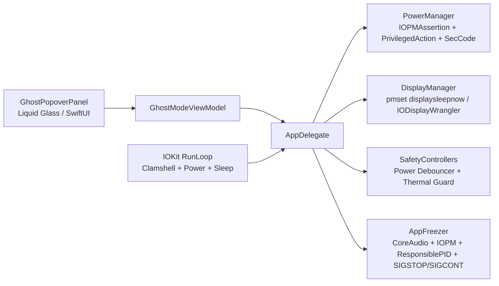

<div align="center">

  

  <h1>Ghost Mode</h1>

  <p>
    <strong>Native closed-lid keep-awake, display power controller, and app freezer for macOS</strong>
  </p>

  <p>
    <a href="https://github.com/malikarpit/Ghost-Mode/actions/workflows/ci.yml"></a>
    <a href="https://github.com/malikarpit/Ghost-Mode/releases/latest"></a>
    
    
    
    <a href="LICENSE"></a>
  </p>

  <p>
    <a href="https://github.com/malikarpit/Ghost-Mode/releases/latest">
      
    </a>
  </p>

  <p>
    <a href="#features">Features</a> &middot;
    <a href="#resource-management--system-impact">Resource Management</a> &middot;
    <a href="#closed-lid-privilege-modes">Privilege Modes</a> &middot;
    <a href="#installation">Installation</a> &middot;
    <a href="#architecture">Architecture</a> &middot;
    <a href="SECURITY.md">Security</a> &middot;
    <a href="CONTRIBUTING.md">Contributing</a>
  </p>

</div>

---

## Why Ghost Mode?

MacBooks normally force sleep the moment you close the lid unless an external monitor, keyboard, and AC adapter are attached. **Ghost Mode** removes that limitation natively—keeping builds, AI agents, servers, downloads, and audio streams alive inside a closed laptop while shutting off the display backlight, freezing idle GUI apps in RAM, and watching battery and thermals in real time.

- **Native macOS 26+ Liquid Glass** (`NSGlassEffectView`) with crisp vibrancy fallback (`NSVisualEffectView`) on macOS 12–15
- **Full-Screen Space ready** (`NSPanel` floating over Desktop and full-screen Spaces alike, anchored smoothly from the menu bar)
- **Zero-dependency Swift** compiled directly with Apple Command Line Tools (`arm64` + `x86_64` Universal 2 binary)

---

## Features

### Session & Display Control

- **Flexible Timers & Presets**: Start for `15m`, `30m`, `45m`, `1h`, `2h`, `4h`, `8h`, or Indefinite (`∞`).
- **Live Extensions & Custom Input**: Add `+15m`, `+30m`, `+1h`, or `∞` mid-session, or type durations like `90m`, `1.5h`, or `45`.
- **1-Click Display Actions**: **Turn Off Screen** (`pmset displaysleepnow` / `IODisplayWrangler`), trigger **Screen Saver**, or shut off the display automatically on lid close.
- **Live Telemetry**: Compact session countdown bar alongside lid state, AC/battery percentage, thermal pressure, and `Kernel: Protected / Normal` status.

### Automated Safety Guards

- **AC Power Only**: Automatically ends an active keep-awake session (debounced) if the MagSafe/USB-C charger is disconnected.
- **Low Battery Cutoff**: Auto-stops at `5%`, `10%`, `15%`, `20%`, or any custom `1–50%` threshold and restores normal system sleep.
- **Thermal Pressure Protection**: Surfaces a warning on sustained elevated heat and exits keep-awake safely on critical thermal pressure.

### Closed-Lid App Isolation & Audio Rules

- **App Freeze (`SIGSTOP` / `SIGCONT`)**: Pauses idle GUI apps in RAM while keeping CLI tools, servers, AI agents, system daemons, and user-whitelisted apps active—with child-first freezing, parent-first resume, orphan recovery (`frozen_pids.json`), and async-signal-safe crash cleanup.
- **Audio Ownership Rules**: Choose **All Except Blocked** or **Only Selected** using `CoreAudio` (`kAudioHardwarePropertyProcessObjectList`), `IOPMCopyAssertionsByProcess`, Cryptex path normalization, and `responsibility_get_pid_responsible_for_pid` so WebKit/Electron media helpers resolve to their owning browser or player.
- **Persistent Rules**: Whitelisted and audio-rule apps remain visible in Preferences even when currently quit.

### Settings, Diagnostics & Lifecycle

- **Startup & Visibility**: Toggle **Default Duration**, menu bar countdown badge, **Auto-Close Panel**, **Auto-Start at Launch**, **Show in Dock**, sound notifications, and native **Launch at Login** (`SMAppService` / LaunchAgent).
- **Passwordless Sudo Setup & Revoke**: Hardened 1-click installer/uninstaller scoped to `pmset` commands.
- **Diagnostics & Reset**: Built-in **Copy Diagnostics**, Reset Defaults, and live Activity Monitor-matched CPU & `phys_footprint` RAM readout in Settings.

---

## Resource Management & System Impact

Ghost Mode is designed to consume virtually **0% CPU** when sitting in the menu bar—even while an active closed-lid session is keeping macOS awake. Instead of background polling loops or repeated shell subprocesses, resource usage is tightly bounded around user interaction and kernel hardware callbacks.

### How Ghost Mode Keeps Overhead Minimal

- **Lazy UI Allocation & 5-Second Idle Teardown** (`StatusBarController`): At launch, Ghost Mode does **not** build its SwiftUI hosting hierarchy (`NSHostingController`), `GhostPopoverPanel`, or `NSGlassEffectView` / `NSVisualEffectView` surfaces until you click the menu bar icon. Closing the popover immediately clears cached app icons and releases the SwiftUI view controller, panel, and compositor backing layers after `5.0s` of inactivity.
- **Visibility-Gated Refreshing** (`AppDelegate`): The `5.0s` UI refresh timer stops whenever the popover is hidden. Background ticks skip `NSRunningApplication` icon extraction, `CoreAudio`/IOPM audio enumeration, `sudo -n` checks, and CPU/RAM diagnostics while closed.
- **Direct IOKit Queries Instead of Subprocesses** (`PowerManager` & `DisplayManager`): Kernel sleep state (`IOPMrootDomain` `"SleepDisabled"`), clamshell state (`AppleClamshellState`), AC/battery events (`IOPSNotificationCreateRunLoopSource`), and sleep callbacks (`IORegisterForSystemPower`) run in-process via C/IOKit APIs rather than spawning `/usr/bin/pmset -g` subprocesses.
- **Event-Driven CoreAudio & Workspace Listeners** (`AppFreezer` & `AppDelegate`): On macOS 14+, closed-lid freeze/unfreeze reconciliation listens directly to CoreAudio process and output-running property notifications (`kAudioHardwarePropertyProcessObjectList` + `kAudioProcessPropertyIsRunningOutput`, debounced `150ms`) plus `NSWorkspace` launch/termination events—eliminating the former 2-second closed-lid polling timer (falling back to a relaxed `15s` check only on macOS 12–13).
- **Accurate Footprint & Interval CPU Reporting** (`ProcessDiagnostics`): In-app diagnostics measure `task_vm_info_data_t.phys_footprint` (matching Activity Monitor's **Memory** column) and interval CPU deltas via `getrusage(RUSAGE_SELF)` + `CLOCK_UPTIME_RAW` rather than inflated VM/RSS totals or cumulative averages.

### Approximate System Resource Effect

Measured on Apple Silicon (`arm64`, macOS 26+) via macOS `footprint` and `ps`:

| State | CPU Usage | Physical Footprint (`phys_footprint`) | CoreAnimation / GPU Layers | What Is Running |
| --- | --- | --- | --- | --- |
| **Background Idle (Launch / Session Active)** | **0.0%** | **~12 MB** | **80 KB** | Status bar item + IOKit RunLoop callbacks only (zero UI/SwiftUI objects allocated) |
| **Popover Open (Active UI)** | **< 1% steady** *(~3% initial open burst)* | **~42–45 MB** | **~7.8 MB** | SwiftUI view graph, `NSGlassEffectView` surface, app icons, `5s` visible telemetry refresh |
| **After Closing Popover (`> 5s` Teardown)** | **0.0%** | **~32 MB** *(cached malloc framework pages; macOS reclaimable as needed)* | **80 KB** | UI hierarchy, icons, and GPU glass backing stores completely released |
| **Before Optimizations (Background Polling + Retained UI)** | *0.0–0.8%* | *~45 MB* | *~6.7 MB retained continuously* | Always-allocated UI, `2s` UI & closed-lid timers, periodic `pmset -g` subprocess forks |

**Whole-System Impact When Lid Is Closed:** Ghost Mode itself adds negligible battery or CPU load (`0.0%` steady CPU, zero subprocess spawning between user actions). When **Turn Off Screen on Lid Close** and **Freeze Apps on Lid Close** are enabled, shutting down panel backlight power and pausing idle background GUI/Electron apps (`0%` CPU under `SIGSTOP`) substantially lowers total system wattage, battery drain, and chassis heat compared to keeping displays or idle foreground apps active while closed.

---

## Closed-Lid Privilege Modes

macOS requires `root` access to toggle kernel sleep (`pmset disablesleep 1/0`). Ghost Mode never elevates silently—it scopes access transparently and disables closed-lid automation controls whenever passwordless sudo is absent:

| Capability | Passwordless Sudo Configured | Not Configured |
| --- | --- | --- |
| Start / stop closed-lid keep-awake | Instant (no prompt) | Prompts for admin password on start/stop |
| Turn Off Screen on Lid Close | Enabled | Visually off &amp; disabled |
| Freeze Apps on Lid Close, Whitelist &amp; Audio Rules | Enabled | Visually off &amp; disabled |
| Safety cutoffs while lid stays closed | Silent sleep restore immediately | Waits in *Sleep Restore Pending* until lid opens |
| Open-lid display keep-awake &amp; battery/thermal guards | Enabled | Enabled (native IOKit assertions) |

---

## Installation

### Prebuilt Universal DMG (Recommended)

1. Download **`GhostMode-Installer.dmg`** (and optionally `GhostMode-Installer.dmg.sha256`) from [**GitHub Releases**](https://github.com/malikarpit/Ghost-Mode/releases/latest).
2. Verify checksum if desired, open the `.dmg`, and drag **Ghost Mode.app** into `/Applications`:
   ```bash
   shasum -a 256 -c GhostMode-Installer.dmg.sha256
   ```
3. **First-Launch Gatekeeper Note**: Community `.dmg` builds are ad-hoc signed without a paid Apple Developer ID certificate. If macOS displays an unverified-developer dialog, Right-Click **Ghost Mode.app &rarr; Open**, or clear quarantine after copying to `/Applications`:
   ```bash
   xattr -d com.apple.quarantine "/Applications/Ghost Mode.app"
   ```

### Build From Source

| Requirement | Details |
| --- | --- |
| **OS** | macOS 12.0+ (Apple Silicon) &middot; macOS 14.0+ (Intel via CLT; macOS 12.0+ with full Xcode) |
| **Toolchain** | Apple Command Line Tools (`xcode-select --install`) or Xcode |

```bash
git clone https://github.com/malikarpit/Ghost-Mode.git
cd Ghost-Mode

# Build Universal 2 bundle (arm64 + x86_64) & run all 222 unit tests
make clean && make all && make test

# Install to /Applications/Ghost Mode.app
make install

# Package GhostMode-Installer.dmg
make dmg

# Remove app & LaunchAgent cleanly
make uninstall
```

---

## Passwordless Sudo Setup & Revocation

- **In App**: **Settings &rarr; Passwordless Sudo &rarr; Setup...** (or **Setup** in the warning banner), and **Revoke...** anytime to remove `/private/etc/sudoers.d/ghostmode`.
- **Terminal Helper**:
  ```bash
  sudo ./ghostmode_setup.sh
  ```

<details>
<summary>Security protections around Setup, Revoke, and App Freezing</summary>

- **Closed `PrivilegedAction` Enum**: No arbitrary command string API is exposed; AppleScript elevation is private to `PowerManager`.
- **No Mutable Script in GUI Flow**: GUI setup constructs its validated command inside the compiled binary rather than reading `ghostmode_setup.sh` from disk.
- **Runtime Code-Signature Verification**: Before any admin elevation, `SecCodeCopySelf` + `SecStaticCodeCreateWithPath` validate both running process and on-disk bundle integrity.
- **Anti-TOCTOU Staging &amp; Least Privilege**: Stages inside a `0700 root:wheel` directory under `0750 root:wheel` `/private/etc/sudoers.d` with locked `PATH`, symlink checks, `visudo -cf`, and strict `Cmnd_Alias GHOSTMODE_PMSET = /usr/bin/pmset disablesleep 0, /usr/bin/pmset disablesleep 1, /usr/bin/pmset -g`.
- **Deadlock-Safe App Freezing**: Excludes core commands (`/bin`, `/sbin`, `/usr/bin`, `/usr/sbin`, `/usr/libexec`, `/System/Library`, `/Library/Apple` + Cryptex), core OS bundles, and Ghost Mode ancestors; freezes child helpers before main apps and resumes parents before helpers, backed by crash orphan recovery (`frozen_pids.json` + async-signal-safe `SIGCONT` handler).

</details>

---

## Architecture



- **Event-Driven Engine**: Hardware, audio, and app lifecycle transitions react to native IOKit RunLoop callbacks (`IOPSNotificationCreateRunLoopSource`, `IOPMrootDomain` clamshell notifications, `IORegisterForSystemPower`), CoreAudio property listeners (`kAudioHardwarePropertyProcessObjectList`, `kAudioProcessPropertyIsRunningOutput`), and `NSWorkspace` launch/termination events instead of polling.
- **Exact Audio Ownership**: Combines `CoreAudio` (`kAudioHardwarePropertyProcessObjectList`), `IOPMCopyAssertionsByProcess`, Cryptex path normalization, and `responsibility_get_pid_responsible_for_pid` so out-of-process WebKit/Electron media renderers map accurately to their owning browser or player.
- **Single-Instance Guard**: Enforced via POSIX `flock` (`O_EXLOCK` semantics) with automatic menu reveal (`DistributedNotificationCenter`) when re-launched.

---

## Support & Community

- **Report a Bug**: Open a [Bug Report](https://github.com/malikarpit/Ghost-Mode/issues/new?template=bug_report.yml) and attach **Settings &rarr; Copy Diagnostics**.
- **Request a Feature**: Start a [Feature Request](https://github.com/malikarpit/Ghost-Mode/issues/new?template=feature_request.yml) or join [Discussions](https://github.com/malikarpit/Ghost-Mode/discussions).
- **Report a Security Issue**: Read [SECURITY.md](SECURITY.md) and submit privately via [GitHub Security Advisories](https://github.com/malikarpit/Ghost-Mode/security/advisories/new).
- **Contribute**: See [CONTRIBUTING.md](CONTRIBUTING.md) and our [Code of Conduct](CODE_OF_CONDUCT.md).

---

<div align="center">
  Developed by <strong>Arpit</strong> &middot; Copyright &copy; 2026 Arpit &middot; <a href="LICENSE">MIT License</a>
</div>
