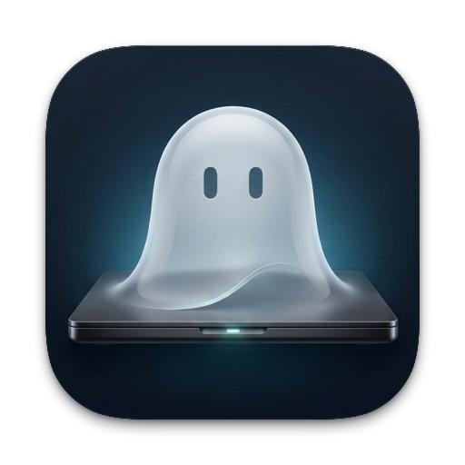
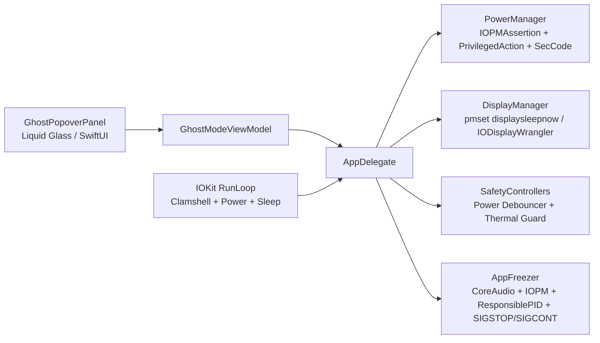

<div align="center">

  

  <h1>Ghost Mode</h1>

  <p>
    <strong>Native closed-lid keep-awake, display power controller, and app freezer for macOS</strong>
  </p>

  <p>
    <a href="https://github.com/malikarpit/Ghost-Mode/actions/workflows/ci.yml"></a>
    <a href="https://github.com/malikarpit/Ghost-Mode/releases/latest"></a>
    
    
    
    <a href="LICENSE"></a>
  </p>

  <p>
    <a href="https://github.com/malikarpit/Ghost-Mode/releases/latest">
      
    </a>
  </p>

  <p>
    <a href="#features">Features</a> &middot;
    <a href="#closed-lid-privilege-modes">Privilege Modes</a> &middot;
    <a href="#installation">Installation</a> &middot;
    <a href="#architecture">Architecture</a> &middot;
    <a href="SECURITY.md">Security</a> &middot;
    <a href="CONTRIBUTING.md">Contributing</a>
  </p>

</div>

---

## Why Ghost Mode?

MacBooks normally force sleep the moment you close the lid unless an external monitor, keyboard, and AC adapter are attached. **Ghost Mode** removes that limitation natively—keeping builds, AI agents, servers, downloads, and audio streams alive inside a closed laptop while shutting off the display backlight, freezing idle GUI apps in RAM, and watching battery and thermals in real time.

- **Native macOS 26+ Liquid Glass** (`NSGlassEffectView`) with crisp vibrancy fallback (`NSVisualEffectView`) on macOS 12–15
- **Full-Screen Space ready** (`NSPanel` floating over Desktop and full-screen Spaces alike, anchored smoothly from the menu bar)
- **Zero-dependency Swift** compiled directly with Apple Command Line Tools (`arm64` + `x86_64` Universal 2 binary)

---

## Features

<table>
  <tr>
    <td valign="top" width="33%">
      <h3>Session</h3>
      <ul>
        <li><strong>Timer Presets</strong>: <code>15m</code>, <code>30m</code>, <code>45m</code>, <code>1h</code>, <code>2h</code>, <code>4h</code>, <code>8h</code>, and Indefinite (<code>&infin;</code>)</li>
        <li><strong>Live Extensions</strong>: <code>+15m</code>, <code>+30m</code>, <code>+1h</code>, <code>&infin;</code>, or natural custom input (<code>90m</code>, <code>1.5h</code>, <code>45</code>)</li>
        <li><strong>Quick Display Actions</strong>: 1-click <strong>Turn Off Screen</strong> &amp; <strong>Screen Saver</strong></li>
        <li><strong>Live Telemetry</strong>: Countdown bar, lid state, AC/battery %, thermal state, and <code>Kernel: Protected / Normal</code> badge</li>
      </ul>
    </td>
    <td valign="top" width="33%">
      <h3>Safety &amp; Isolation</h3>
      <ul>
        <li><strong>AC Power Only</strong>: Ends session if power adapter disconnects (debounced)</li>
        <li><strong>Low Battery Cutoff</strong>: Auto-stops at <code>5%</code>, <code>10%</code>, <code>15%</code>, <code>20%</code>, or custom <code>1–50%</code></li>
        <li><strong>Thermal Protection</strong>: Warns on sustained elevated heat; exits on critical pressure</li>
        <li><strong>App Freeze &amp; Whitelist</strong>: Suspends idle GUI apps via <code>SIGSTOP</code>/<code>SIGCONT</code> while keeping whitelisted and non-running saved rules visible</li>
        <li><strong>Audio App Rules</strong>: <em>All Except Blocked</em> or <em>Only Selected</em> via CoreAudio, IOKit &amp; WebKit/Cryptex ownership mapping</li>
      </ul>
    </td>
    <td valign="top" width="33%">
      <h3>Settings &amp; Control</h3>
      <ul>
        <li><strong>Default 1-Click Duration</strong> &amp; optional menu bar countdown badge</li>
        <li><strong>Auto-Close Panel</strong> on start &amp; <strong>Auto-Start at Launch</strong></li>
        <li><strong>Show in Dock</strong> toggle, Sound Notifications, and native <strong>Launch at Login</strong> (<code>SMAppService</code> / LaunchAgent)</li>
        <li><strong>Passwordless Sudo</strong>: Hardened 1-click Setup &amp; clean Revoke</li>
        <li><strong>Diagnostics &amp; Footprint</strong>: 1-click <strong>Copy Diagnostics</strong>, Reset Defaults, live CPU &amp; RAM readout</li>
      </ul>
    </td>
  </tr>
</table>

---

## Closed-Lid Privilege Modes

macOS requires `root` access to toggle kernel sleep (`pmset disablesleep 1/0`). Ghost Mode never elevates silently—it scopes access transparently and disables closed-lid automation controls whenever passwordless sudo is absent:

| Capability | Passwordless Sudo Configured | Not Configured |
| --- | --- | --- |
| Start / stop closed-lid keep-awake | Instant (no prompt) | Prompts for admin password on start/stop |
| Turn Off Screen on Lid Close | Enabled | Visually off &amp; disabled |
| Freeze Apps on Lid Close, Whitelist &amp; Audio Rules | Enabled | Visually off &amp; disabled |
| Safety cutoffs while lid stays closed | Silent sleep restore immediately | Waits in *Sleep Restore Pending* until lid opens |
| Open-lid display keep-awake &amp; battery/thermal guards | Enabled | Enabled (native IOKit assertions) |

---

## Installation

### Prebuilt Universal DMG (Recommended)

1. Download **`GhostMode-Installer.dmg`** (and optionally `GhostMode-Installer.dmg.sha256`) from [**GitHub Releases**](https://github.com/malikarpit/Ghost-Mode/releases/latest).
2. Verify checksum if desired, open the `.dmg`, and drag **Ghost Mode.app** into `/Applications`:
   ```bash
   shasum -a 256 -c GhostMode-Installer.dmg.sha256
   ```
3. **First-Launch Gatekeeper Note**: Community `.dmg` builds are ad-hoc signed without a paid Apple Developer ID certificate. If macOS displays an unverified-developer dialog, Right-Click **Ghost Mode.app &rarr; Open**, or clear quarantine after copying to `/Applications`:
   ```bash
   xattr -d com.apple.quarantine "/Applications/Ghost Mode.app"
   ```

### Build From Source

| Requirement | Details |
| --- | --- |
| **OS** | macOS 12.0+ (Apple Silicon) &middot; macOS 14.0+ (Intel via CLT; macOS 12.0+ with full Xcode) |
| **Toolchain** | Apple Command Line Tools (`xcode-select --install`) or Xcode |

```bash
git clone https://github.com/malikarpit/Ghost-Mode.git
cd Ghost-Mode

# Build Universal 2 bundle (arm64 + x86_64) & run all 215 unit tests
make clean && make all && make test

# Install to /Applications/Ghost Mode.app
make install

# Package GhostMode-Installer.dmg
make dmg

# Remove app & LaunchAgent cleanly
make uninstall
```

---

## Passwordless Sudo Setup & Revocation

- **In App**: **Settings &rarr; Passwordless Sudo &rarr; Setup...** (or **Setup** in the warning banner), and **Revoke...** anytime to remove `/private/etc/sudoers.d/ghostmode`.
- **Terminal Helper**:
  ```bash
  sudo ./ghostmode_setup.sh
  ```

<details>
<summary>Security protections around Setup, Revoke, and App Freezing</summary>

- **Closed `PrivilegedAction` Enum**: No arbitrary command string API is exposed; AppleScript elevation is private to `PowerManager`.
- **No Mutable Script in GUI Flow**: GUI setup constructs its validated command inside the compiled binary rather than reading `ghostmode_setup.sh` from disk.
- **Runtime Code-Signature Verification**: Before any admin elevation, `SecCodeCopySelf` + `SecStaticCodeCreateWithPath` validate both running process and on-disk bundle integrity.
- **Anti-TOCTOU Staging &amp; Least Privilege**: Stages inside a `0700 root:wheel` directory under `0750 root:wheel` `/private/etc/sudoers.d` with locked `PATH`, symlink checks, `visudo -cf`, and strict `Cmnd_Alias GHOSTMODE_PMSET = /usr/bin/pmset disablesleep 0, /usr/bin/pmset disablesleep 1, /usr/bin/pmset -g`.
- **Deadlock-Safe App Freezing**: Excludes core commands (`/bin`, `/sbin`, `/usr/bin`, `/usr/sbin`, `/usr/libexec`, `/System/Library`, `/Library/Apple` + Cryptex), core OS bundles, and Ghost Mode ancestors; freezes child helpers before main apps and resumes parents before helpers, backed by crash orphan recovery (`frozen_pids.json` + async-signal-safe `SIGCONT` handler).

</details>

---

## Architecture



- **Event-Driven Engine**: Hardware state reacts to native IOKit RunLoop callbacks (`IOPSNotificationCreateRunLoopSource`, `IOPMrootDomain` clamshell notifications, `IORegisterForSystemPower`) instead of busy polling.
- **Exact Audio Ownership**: Combines `CoreAudio` (`kAudioHardwarePropertyProcessObjectList`), `IOPMCopyAssertionsByProcess`, Cryptex path normalization, and `responsibility_get_pid_responsible_for_pid` so out-of-process WebKit/Electron media renderers map accurately to their owning browser or player.
- **Single-Instance Guard**: Enforced via POSIX `flock` (`O_EXLOCK` semantics) with automatic menu reveal (`DistributedNotificationCenter`) when re-launched.

---

## Support & Community

- **Report a Bug**: Open a [Bug Report](https://github.com/malikarpit/Ghost-Mode/issues/new?template=bug_report.yml) and attach **Settings &rarr; Copy Diagnostics**.
- **Request a Feature**: Start a [Feature Request](https://github.com/malikarpit/Ghost-Mode/issues/new?template=feature_request.yml) or join [Discussions](https://github.com/malikarpit/Ghost-Mode/discussions).
- **Report a Security Issue**: Read [SECURITY.md](SECURITY.md) and submit privately via [GitHub Security Advisories](https://github.com/malikarpit/Ghost-Mode/security/advisories/new).
- **Contribute**: See [CONTRIBUTING.md](CONTRIBUTING.md) and our [Code of Conduct](CODE_OF_CONDUCT.md).

---

<div align="center">
  Developed by <strong>Arpit</strong> &middot; Copyright &copy; 2026 Arpit &middot; <a href="LICENSE">MIT License</a>
</div>
