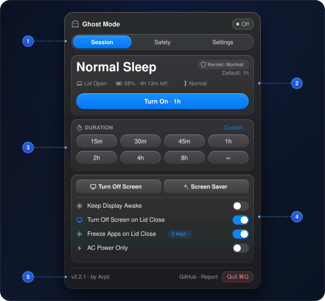
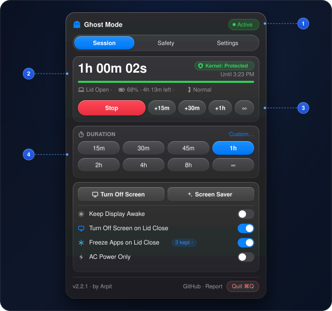
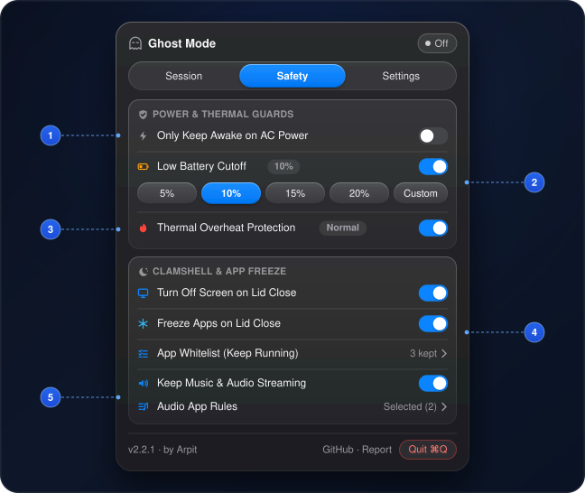
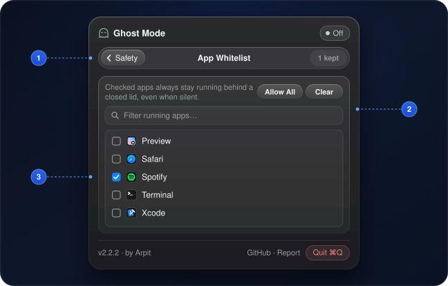
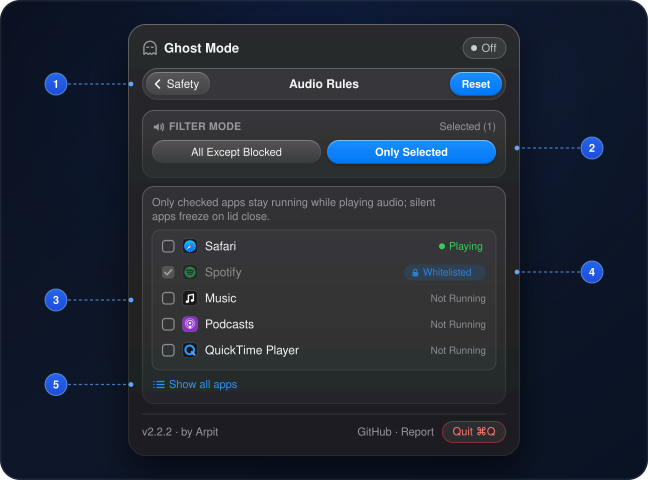
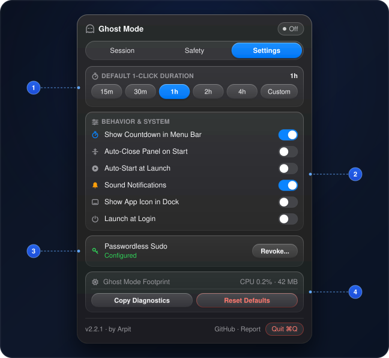

# Ghost Mode User Guide

An annotated, screen-by-screen vector walkthrough of every control, label, indicator, and workflow in **Ghost Mode v2.2.1**.

---

## Menu Bar Icon & Right-Click Menu

Ghost Mode lives in your macOS menu bar and changes its icon to reflect the active hardware and session state:

| Icon State | Meaning |
| --- | --- |
| **Sleeping Ghost (Outlined)** | **Normal Sleep** — Ghost Mode is idle; macOS sleeps normally. |
| **Awake Ghost (Solid)** | **Stay Awake** — Keep-awake session is active (lid open). |
| **Stealth Ghost (With Lid Bar)** | **Closed-Lid Active** — Keep-awake session is active with the MacBook lid closed. |
| **Warning Triangle (`!`)** | **Sleep Restore Pending** — Session stopped behind a closed lid without Passwordless Sudo; open the lid or click **Restore Normal Sleep**. |

When **Show Countdown in Menu Bar** is enabled in **Settings**, the remaining time appears beside the ghost icon (`42m`, `1h 15m`, etc.).

**Right-Click Context Menu:**
- **Turn On** / **Turn Off** — Start using your default duration or stop the active session
- **+15m** · **+30m** · **+1h** — Extend an active session directly from the menu bar
- **Turn Off Screen Now** · **Screen Saver** — Trigger display power-off or macOS Screen Saver immediately
- **Unfreeze All** — Resume any processes currently paused by App Freeze *(shown when apps are frozen)*
- **Settings...** — Open Ghost Mode directly to the **Settings** tab
- **Quit Ghost Mode** (`⌘Q`) — Unfreeze any paused apps, release power assertions, and restore normal sleep

---

## 1. Session Tab

### Idle State (`Normal Sleep`)

  

1. **Top Header & Segmented Tabs (`Session` · `Safety` · `Settings`)**:
   - **Status Pill (`Off` / `Active`)**: Shows whether Ghost Mode is currently keeping your Mac awake.
   - **Tabs**: Switch between **Session**, **Safety**, and **Settings**.
2. **Hero Status Card**:
   - **`Normal Sleep`** / **`Kernel: Normal`**: Confirms macOS closed-lid and idle sleep are untouched (`SleepDisabled = 0`).
   - **`Default: <Duration>`**: Shows the 1-click duration configured in **Settings**.
   - **Live Hardware Telemetry**: Displays real-time lid state (`Lid Open` / `Lid Closed` / `Desktop Mac`), battery percentage and remaining time (or `AC Power`), and system thermal state (`Normal`, `Elevated`, `Hot`, `Critical`).
   - **`Turn On · <Duration>`**: Starts a keep-awake session immediately using your default duration.
3. **`DURATION` Card**:
   - **Presets (`15m`, `30m`, `45m`, `1h`, `2h`, `4h`, `8h`, `∞`)**: Click any preset to immediately start a session for that duration (or switch an active session's remaining time).
   - **`Custom...`**: Reveals a custom input field accepting formats like `90m`, `1.5h`, `45` (minutes), or `0` / `∞` for indefinite.
4. **Display Actions & Quick Controls**:
   - **`Turn Off Screen`** · **`Screen Saver`**: Instantly blanks the display (`pmset displaysleepnow` / `IODisplayWrangler`) or launches Screen Saver.
   - **`Keep Display Awake`**: Prevents *open-lid* idle display sleep while a session is active (`kIOPMAssertPreventUserIdleDisplaySleep`).
   - **`Turn Off Screen on Lid Close`**: Automatically blanks the built-in display as soon as the MacBook lid shuts *(requires Passwordless Sudo)*.
   - **`Freeze Apps on Lid Close`** (`N kept ›` / `N frozen` / `Configure ›`): Suspends idle GUI apps via `SIGSTOP` when the lid shuts while leaving terminal/CLI tasks, whitelisted apps, and allowed audio apps running *(requires Passwordless Sudo)*.
   - **`AC Power Only`**: Ends keep-awake automatically if your charger disconnects.
5. **Footer (`v2.2.1 · by Arpit` · `GitHub` · `Report` · `Quit ⌘Q`)**: Opens the GitHub repository, bug report page, or cleanly quits Ghost Mode.

---

### Active State (`Stay Awake`)

  

1. **Active Header Pill (`• Active`)**: Turns green alongside the solid blue ghost header icon while keep-awake is running.
2. **Live Countdown & `Kernel: Protected` Badge**: Counts down remaining time (`1h 00m 02s`, `Until <Time>`), confirms `SleepDisabled = 1` + native IOKit assertions, or shows `Indefinite` during `∞` sessions.
3. **Active Action Row (`Stop` · `+15m` · `+30m` · `+1h` · `∞`)**: Stop immediately (unfreezing paused apps and restoring normal sleep), add time on the fly, or switch to indefinite mode.
4. **Active Duration Highlight**: Marks the matching preset pill in blue; selecting another preset updates the active timer immediately.
*(If a safety cutoff stops a session behind a closed lid without Passwordless Sudo, the hero card shows **`Restore Normal Sleep`** so you can authorize cleanup once the lid opens.)*

---

## 2. Safety Tab

  

1. **`Only Keep Awake on AC Power`**: Syncs with **AC Power Only** on the Session tab. Debounced so brief adapter flickers won't interrupt a session.
2. **`Low Battery Cutoff`** (`5%`, `10%`, `15%`, `20%`, `Custom`): Automatically stops keep-awake and restores sleep if battery drops to or below the selected `1–50%` threshold.
3. **`Thermal Overheat Protection`** *(with live `Normal` / `Elevated` / `Hot` / `Critical` pill)*: Alerts you if elevated heat persists and automatically stops keep-awake under sustained critical thermal pressure.
4. **`CLAMSHELL & APP FREEZE`** *(Requires **Passwordless Sudo** on laptops; hidden as unavailable on desktop Macs)*:
   - **`Unfreeze All (N)`** *(appears when apps are paused)*: Resumes all suspended apps immediately without waiting to open the lid.
   - **`Turn Off Screen on Lid Close`**: Powers down the screen backlight when the lid closes during an active session.
   - **`Freeze Apps on Lid Close`**: Suspends idle regular GUI apps while keeping CLI processes, background services, core macOS processes, and your whitelist running.
   - **`App Whitelist (Keep Running)`** (`N kept ›`): Opens the App Whitelist view.
5. **Audio Protection**:
   - **`Keep Music & Audio Streaming`**: Protects apps actively outputting audio from being paused behind a closed lid.
   - **`Audio App Rules`** (`Selected (N)` / `N blocked` / `All allowed` ›): Opens the Audio Rules filter view.

---

## 3. App Whitelist (Keep Running)

  

1. **Navigation Header (`< Safety` · `App Whitelist` · `N kept`)**: Returns to Safety or shows how many apps are permanently kept awake.
2. **Batch Controls (`Allow All` · `Clear`) & Live Search (`Filter running apps...`)**: Adds every currently running regular app, clears all rules, or filters by app name / bundle ID.
3. **App Rows**: Checked apps always stay running when the lid closes. Any previously frozen app that is unchecked can show a `Frozen` badge until resumed, and saved rules for quit apps appear under **`SAVED · NOT CURRENTLY RUNNING`**.

> **Built-in Protection:** Terminal/CLI tools, AI agents, system daemons, Finder, Dock, WindowManager, CoreAudio, and Ghost Mode itself are never frozen.

---

## 4. Audio Rules

  

1. **Navigation Header (`< Safety` · `Audio Rules` · `Reset`)**: Returns to Safety or restores the default audio rule set.
2. **`FILTER MODE` (`All Except Blocked` · `Only Selected`)**:
   - **`All Except Blocked`**: Any app playing audio stays unfrozen unless you check it to block.
   - **`Only Selected`**: Only checked apps (for example `Safari` and `Spotify` above) are permitted to stay awake for audio when the lid closes.
3. **Allowed Audio Apps & Live `Playing` Indicator**: Green live dot shown next to any app currently outputting sound via CoreAudio / IOKit power assertions—including browser media helpers (WebKit/Chromium) mapped back to their parent app.

---

## 5. Settings Tab

  

1. **`DEFAULT 1-CLICK DURATION`**: Choose what **`Turn On · <Duration>`** starts with (`15m`, `30m`, `1h`, `2h`, `4h`, or **`Custom`**).
2. **`BEHAVIOR & SYSTEM`**:
   - **`Show Countdown in Menu Bar`**: Displays remaining time next to the menu bar ghost icon while finite sessions run.
   - **`Auto-Close Panel on Start`**: Automatically dismisses the popover as soon as you start a keep-awake session.
   - **`Auto-Start at Launch`**: Starts a keep-awake session using your default duration whenever Ghost Mode launches.
   - **`Sound Notifications`**: Plays the default notification sound alongside Ghost Mode banners.
   - **`Show App Icon in Dock`**: Switches Ghost Mode between pure menu-bar accessory mode and showing an icon in the Dock / `⌘Tab` switcher.
   - **`Launch at Login`**: Registers Ghost Mode via `SMAppService` (macOS 13+) or LaunchAgent (macOS 12). If macOS asks for approval, an **`Open`** shortcut takes you straight to *System Settings → General → Login Items*.
3. **`Passwordless Sudo`**: Shows **`Configured`** (`Revoke...`) or **`Not Configured`** (`Setup...`). **`Setup...`** writes a strict rule at `/private/etc/sudoers.d/ghostmode` scoped exclusively to `/usr/bin/pmset disablesleep 0/1` and `/usr/bin/pmset -g` after validating bundle integrity with `SecCode`. **`Revoke...`** removes it cleanly.
4. **Diagnostics & Maintenance**:
   - **`Ghost Mode Footprint`** (`CPU x.x% · y MB`): Live interval CPU usage and true macOS Activity Monitor `phys_footprint` RAM.
   - **`Copy Diagnostics`**: Copies app version, OS/hardware info, power/thermal snapshot, frozen PIDs, active assertions, and safety state to your clipboard for bug reports.
   - **`Reset Defaults`**: Restores all preferences (with inline confirmation) back to factory defaults.
